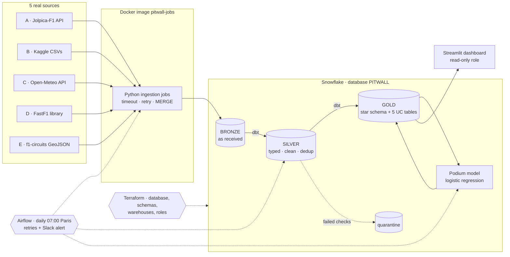

# 🏎️ PitWall Analytics · F1 data pipeline

> **Fictional company, real public data.** PitWall Analytics sells Formula 1 insights to fantasy-league players
> and sports media. This repository contains the complete data pipeline behind its five products, from five real
> public sources to a podium prediction for the **next Grand Prix: São Paulo, 8 November 2026**.
> The pipeline always targets the next race of the calendar (`dim_race.is_next_race`), so after São Paulo it moves
> on to the following Grand Prix by itself.

Data Engineering group project · team of 2 data engineers · stack: **Python · Docker · Snowflake · dbt · Airflow ·
Terraform · Streamlit**.

---

## Table of contents
1. [The company](#1-the-company)
2. [Five use cases](#2-five-use-cases)
3. [Five real data sources](#3-five-real-data-sources)
4. [Architecture](#4-architecture)
5. [Repository structure](#5-repository-structure)
6. [Data model: bronze → silver → gold](#6-data-model-bronze--silver--gold)
7. [How we predict the next race](#7-how-we-predict-the-next-race)
8. [Data quality and reliability](#8-data-quality-and-reliability)
9. [Orchestration](#9-orchestration)
10. [Infrastructure as code](#10-infrastructure-as-code)
11. [Security](#11-security)
12. [Costs](#12-costs)
13. [How to run it](#13-how-to-run-it)
14. [Design decisions and alternatives](#14-design-decisions-and-alternatives)
15. [Limitations and next steps](#15-limitations-and-next-steps)
16. [Where to find the evidence (grading grid)](#16-where-to-find-the-evidence-grading-grid)

---

## 1. The company

| | |
|---|---|
| **Name** | PitWall Analytics (fictional) |
| **What we sell** | Data-driven F1 insights: who will finish on the podium, rain risk, safety-car risk, strategy, overtakes |
| **Customers** | Fantasy F1 players (B2C subscription, *assumed* €4.99/month) and sports media (B2B licence for race previews) |
| **Rhythm** | 24 Grands Prix per season; insights refreshed after every session (practice, qualifying, race) |
| **Team** | 2 data engineers: one owns ingestion and platform, one owns modelling and product |
| **Constraints** | predictions published within 2 h after qualifying · cloud budget ≤ 10 Snowflake credits/month |

**Why OLAP, not OLTP:** we read large amounts of history (every race since 1950) to compute averages and trends,
and we write in batches. That is an analytical workload: a columnar warehouse (Snowflake) and a star schema.
OLTP only exists upstream (behind the APIs) and would only appear here if the app stored user picks (a Postgres
database next to the warehouse).

## 2. Five use cases

| # | Use case | User → decision | Metric (grain) | When | Accepted if | Gold table |
|---|---|---|---|---|---|---|
| 1 | **Podium prediction** | Fantasy player → which drivers to pick | P(podium) per race × driver | after each session, final after qualifying | the backtest finds more podium finishers than "top 3 of the grid" | `UC1_PODIUM_PREDICTIONS` |
| 2 | **Places gained** | Journalist → which story to cover | grid − finish per race × driver | Monday after the race | equals a hand-run SQL check on 3 races | `UC2_PLACES_GAINED` |
| 3 | **Pit strategy** | TV analyst → which strategy to explain | stops and compounds per circuit (last 3 seasons) | before the race week | matches the race reports of 3 races | `UC3_PIT_STRATEGY` |
| 4 | **Rain alert** | Fantasy player → change picks before the deadline | max rain probability per session window (LOW / MEDIUM ≥ 30 % / HIGH ≥ 60 %) | daily during the race week | forecast vs rain measured at the track after the race | `UC4_RAIN_ALERT` |
| 5 | **Safety-car risk** | Media → angle of the race preview | share of races with SC or VSC per circuit (last 5 seasons) | before the race week | equals the count of SC flags in FastF1 | `UC5_SAFETY_CAR_RISK` |

Excluded everywhere: cancelled races and non-starters. Details in [`docs/decisions.md`](docs/decisions.md).

## 3. Five real data sources

| | Source | What we take | Ingestion mode | Bronze table(s) |
|---|---|---|---|---|
| **A** | [Jolpica-F1 API](https://github.com/jolpica/jolpica-f1) (successor of Ergast) | calendar, results, qualifying, pit stops | **incremental API pull** with a watermark (last round loaded) | `JOLPICA_RAW` (raw JSON) |
| **B** | [Kaggle · Formula 1 World Championship (1950-2024)](https://www.kaggle.com/datasets/rohanrao/formula-1-world-championship-1950-2020) | 75 years of history | **one-off batch** CSV load | `KAGGLE_*` (8 tables, text) |
| **C** | [Open-Meteo](https://open-meteo.com/) (forecast + archive) | hourly weather at each circuit | **API pull**: archive once per past race, forecast daily for the next race | `WEATHER_RAW` (raw JSON) |
| **D** | [FastF1](https://docs.fastf1.dev/) (official F1 live-timing data) | practice pace, tyre stints, track status, track weather, classifications | **Python library** → DataFrame → `write_pandas` | `FASTF1_*` (5 tables) |
| **E** | [f1-circuits](https://github.com/bacinger/f1-circuits) (GeoJSON) | track outlines, length, altitude | **static file**, loaded once | `CIRCUITS_RAW` (raw JSON) |

Every source feeds at least three use cases:

| Use case | A | B | C | D | E |
|---|:-:|:-:|:-:|:-:|:-:|
| 1 Podium | yes | yes | yes | yes | yes |
| 2 Places gained | yes | yes | yes | — | yes |
| 3 Pit strategy | yes | yes | yes | yes | — |
| 4 Rain alert | yes | — | yes | yes | yes |
| 5 Safety-car risk | — | yes | — | yes | yes |

## 4. Architecture



The same diagram, hand-drawn style, is in [`docs/architecture.excalidraw`](docs/architecture.excalidraw)
(open it on [excalidraw.com](https://excalidraw.com) › Open).

| Step | What happens | Tool | Guarantee |
|---|---|---|---|
| 1 Ingest | each source is called by a Python job | Docker, `requests`, FastF1 | timeout, retry on 429/5xx, loud failure |
| 2 Load | rows uploaded to a Snowflake stage, then merged | `write_pandas` + `MERGE` | a replay never duplicates |
| 3 Bronze | data kept exactly as received (+ `_source`, `_loaded_at`, `_run_id`) | Snowflake, VARIANT for JSON | replay and debugging possible |
| 4 Silver | typed, cleaned, de-duplicated; impossible rows quarantined | dbt | deterministic "which version wins" |
| 5 Gold | star schema + one table per use case | dbt + tests | tested grain, business rules |
| 6 Model | trains on every finished race, recent seasons weigh most | scikit-learn | backtested against the grid baseline |
| 7 Predict | scores the next race | Python job | predictions replaced, never appended |
| 8 Serve | dashboard on gold only | Streamlit in Snowflake | read-only role |

## 5. Repository structure

```
pitwall-f1/
├── ingest/                      Docker image "pitwall-jobs"
│   ├── common.py                Snowflake key-pair connection, API calls with retry, MERGE helpers
│   ├── ingest_jolpica.py        A · incremental pull with watermark (+ next race qualifying)
│   ├── load_kaggle.py           B · one-off batch load of 8 CSV files
│   ├── ingest_weather.py        C · archive for past races, forecast for the next race
│   ├── ingest_fastf1.py         D · laps, stints, track status, weather, classifications
│   ├── load_circuits.py         E · GeoJSON circuits file
│   ├── predict_podium.py        UC1 model: backtest + prediction of the next race
│   └── Dockerfile, requirements.txt, .dockerignore
├── dbt/                         Docker image "pitwall-dbt"
│   └── pitwall_dbt/
│       ├── models/sources.yml   bronze sources + freshness rules
│       ├── models/silver/       10 models: races, results (+ checks, quarantine), qualifying, pit stops, weather, circuits, FastF1
│       ├── models/gold/         star schema (fact + 5 dimensions) + 5 use-case tables
│       ├── macros/              cleaning rules (\N → NULL, "1:29.179" → seconds, race_id, run_date)
│       └── tests/               business rules, completeness, quarantine rate, generic key test
├── airflow/                     docker-compose (standalone), DAGs pitwall_daily + pitwall_backfill
├── terraform/                   Snowflake: database, 3 schemas, 2 warehouses (module), 2 roles, grants
├── streamlit/                   dashboard of the 5 use cases (gold only)
├── sql/                         access check, budget monitor, incident drills, shutdown
├── docs/                        decisions, incidents, costs & security, oral guide (FR), Excalidraw diagram
├── tests/                       unit tests + model backtest on real 2024-2025 race weekends
└── .github/workflows/ci.yml     runs the unit tests on every push
```

## 6. Data model: bronze → silver → gold

**Bronze** keeps everything as received: raw JSON in `VARIANT` columns (APIs, GeoJSON) and text columns (CSV,
FastF1), always with `_source`, `_loaded_at`, `_run_id`.

**Silver** (dbt) types, cleans and de-duplicates:

| Model | Grain | Notes |
|---|---|---|
| `stg_races` | race (`season-round`) | Jolpica calendar first, Kaggle history second |
| `int_results_checked` → `silver_results` / `results_quarantine` | race × driver | every row gets a list of problems; bad rows go to quarantine with their reason |
| `stg_qualifying`, `stg_pit_stops` | race × driver (× stop) | lap times "1:29.179" → seconds |
| `stg_weather_hourly` | race × kind × hour | flattened Open-Meteo arrays, UTC |
| `stg_circuits` | circuit | GeoJSON matched to the calendar by position (closest track centre) |
| `stg_fastf1_results` | race × session × driver | **repairs FastF1 race time** (winner time + gap) |
| `stg_practice_pace`, `stg_race_events`, `stg_tyre_stints` | race × driver / race | practice gap, safety cars / VSC / red flags, rain measured, tyre stints |

**Gold** is a star schema plus one table per use case:

```
                 dim_race (race_id, season, round, date, is_next_race)
                         │
dim_driver ──── fact_race_result (race_id × driver_ref) ──── dim_circuit
                 │      grid · finish · points · pit stops     (length, altitude, GPS)
dim_constructor ─┘                 │
                              dim_weather (rain, temperature, wet race)
```

Use-case tables: `uc1_podium_features` (+ `UC1_PODIUM_PREDICTIONS`, `UC1_MODEL_BACKTEST` written by the model),
`uc2_places_gained`, `uc3_pit_strategy`, `uc4_rain_alert`, `uc5_safety_car_risk`.

## 7. How we predict the next race

**Model:** a logistic regression (one weight per input: easy to explain), implemented in
[`ingest/predict_podium.py`](ingest/predict_podium.py).

**The latest information only** is used for São Paulo:

| Input | Most recent value used | Source |
|---|---|---|
| Form | average finish over the last 5 races | A |
| Team | team points over the last 5 races | A |
| Interlagos | the driver's past finishes at this circuit | B + A |
| Grid | qualifying of Saturday 7 Nov (before that: recent average finish) | A |
| Pace | best practice lap gap to the fastest, Friday 6 Nov | D |
| Rain | forecast for the race window | C |

**Most recent seasons weigh most:** the model trains on every finished race, but each season back counts half as
much (2026 ×1, 2025 ×0.5, 2024 ×0.25...), because the cars change every year, and completely in 2026.
No leakage: every "form" input only looks at races **before** the one predicted.

**Acceptance test (backtest):** for each race, how many of the 3 drivers the model ranks highest really finished on
the podium, compared with the naive "top 3 of the grid". On real 2024 → 2025 data (unit test):

| Season tested | Races | Model | Grid baseline | Accepted |
|---|---|---|---|---|
| 2025 (trained on 2024) | 21 | **79.4 %** | 76.2 % | ✅ |
| 2026 so far (trained on ≤ 2025) | computed at each run in `GOLD.UC1_MODEL_BACKTEST` | | | |

The prediction is recomputed after every session: Friday practice → Saturday qualifying → final before Sunday.

## 8. Data quality and reliability

| Check | Type | Where |
|---|---|---|
| unique `race_id × driver_ref` in silver, fact and UC tables | **key** | `unique_combination` (generic test, no package) |
| exactly one winner per finished race | **business rule** | `tests/assert_one_winner_per_race.sql` |
| nobody finishes faster than the winner | **business rule** | `tests/assert_race_time_not_below_winner.sql` |
| a race finished > 2 days ago has its results in gold | **completeness** | `tests/assert_completed_races_have_results.sql` |
| bronze reloaded within 30 h (warn) / 3 days (error) | **freshness** | `sources.yml` + `dbt source freshness` |
| less than 5 % of results quarantined | source health | `tests/assert_quarantine_below_5_percent.sql` |
| relationships fact → dimensions, accepted values | integrity | `schema.yml` |

**A real data bug, found and fixed:** in FastF1 race classifications (2024-2025), `Time` is the total race time only
for the winner; for the other **530 of 575 classified drivers** it is the gap to the winner (e.g. 39.669 s).
Silver rebuilds the total time (winner time + gap) and the business-rule test catches it if it comes back.

**Idempotency:** every load is a `MERGE` on the business key, silver de-duplicates with a deterministic
`qualify row_number()`, predictions are replaced (DELETE + INSERT in one transaction). Re-running a day never
double-counts. `dbt build` skips everything downstream of a failed test, so bad data never reaches the dashboard.

**Incident scenarios** ([`docs/incidents.md`](docs/incidents.md), drills in [`sql/03_incident_drills.sql`](sql/03_incident_drills.sql)):
- **A · API down / rate limited** → retries, then Slack alert; the next run catches up from the watermark.
  Live drill: *Trigger DAG w/ config* `{"simulate_outage": "1"}`.
- **B · same day loaded twice** → identical counts before / after (MERGE + dedup).
- **C · impossible result injected (two winners)** → `dbt build` fails on the business rule, gold is not updated.

## 9. Orchestration

Airflow (course setup: standalone, `DockerOperator`), [`airflow/dags/`](airflow/dags):

```
pitwall_daily (07:00 Europe/Paris)
  ingest_jolpica ──> ingest_weather ──┐
  ingest_fastf1 ──────────────────────┴──> dbt_build (freshness + build) ──> predict_podium

pitwall_backfill (manual, once)
  load_circuits · load_kaggle · jolpica_2025 · fastf1_history ──> weather_history
```

Retries: 2 (5 min apart) · alert after the last retry (Slack/Teams webhook) · `max_active_runs=1` ·
the date comes from the run (`{{ ds }}`), never from "today", so backfills work. Batch, not streaming:
decisions are taken once per session.

## 10. Infrastructure as code

[`terraform/`](terraform) (Snowflake provider, pinned `~> 2.22`): database `PITWALL`, schemas
`BRONZE/SILVER/GOLD`, two XSMALL warehouses from one module (auto-suspend 60 s), roles `PITWALL_PIPELINE` and
`PITWALL_ANALYST`, grants. State never committed; remote, versioned, locked backend in `backend.tf.example`.
Commands: `terraform init` → `plan` → `apply`; `plan` again shows drift; `destroy` at the end.

**Manual steps (listed on purpose):** Snowflake trial and admin user · RSA key on the user · Kaggle download ·
budget monitor (ACCOUNTADMIN) · remote state workspace · Slack webhook.

## 11. Security

- **Least privilege:** the dashboard role reads GOLD only. Proof: [`sql/01_access_check.sql`](sql/01_access_check.sql)
  (gold allowed, bronze denied, delete denied).
- **Secrets:** key-pair authentication; the private key is mounted read-only at run time, never in an image or in Git
  (`.gitignore`, `.dockerignore`); `.env` and `terraform.tfvars` are not committed.
- **Personal data:** the data is public, but drivers are people: gold keeps the birth year only, not the full date.

## 12. Costs

| Item | Assumption | Credits / month |
|---|---|---|
| Daily run on XSMALL (1 credit/h) | ~6 min/day | ≈ 3 |
| Race-weekend extra runs | 4 weekends × 3 runs × 6 min | ≈ 1.2 |
| Dashboard warehouse (10-min cache) | ~5 min/day | ≈ 2.5 |
| One-off backfill | ~30 min once | 0.5 |
| **Total** | at an assumed €3/credit | **≈ 7 credits ≈ €20/month** |

×10 customers → only the dashboard warehouse grows → ≈ 30 credits ≈ €90/month (cost driver = readers, not data).
Budget alert: resource monitor at 10 credits/month, e-mail at 50 % and 80 %, suspend at 100 %
([`sql/02_budget_monitor.sql`](sql/02_budget_monitor.sql)). Shutdown: [`sql/04_shutdown_cleanup.sql`](sql/04_shutdown_cleanup.sql).
Replace the estimates with the measured credits (last query of the budget script).

## 13. How to run it

**Prerequisites:** Snowflake account (trial is enough) with your RSA public key on your user, Docker Desktop,
Terraform ≥ 1.9, a free Kaggle account.

```bash
# 0. Unit tests (no Snowflake, no network needed)
pip install pandas scikit-learn pytest requests
pytest tests -s

# 1. Infrastructure
cd terraform && cp terraform.tfvars.example terraform.tfvars      # fill it in
terraform init && terraform plan && terraform apply
# then run sql/02_budget_monitor.sql in Snowsight (ACCOUNTADMIN)

# 2. Images
docker build -t pitwall-jobs:1.0.0 ingest/
docker build -t pitwall-dbt:1.0.0 dbt/

# 3. Airflow
cd airflow && cp .env.example .env                                # fill it in
docker compose up                                                 # http://localhost:8080

# 4. History: download "Formula 1 World Championship (1950 - 2024)" from Kaggle into PITWALL_KAGGLE_DIR,
#    then trigger the DAG  pitwall_backfill

# 5. Daily pipeline: unpause / trigger  pitwall_daily  (the Graph view is the live demo)

# 6. Dashboard: Snowsight › Projects › Streamlit › + Streamlit App, paste streamlit/streamlit_app.py
#    (warehouse PITWALL_BI_WH, role PITWALL_ANALYST)
```

Any job also runs alone, e.g.
`docker run --rm -e SNOWFLAKE_ACCOUNT -e SNOWFLAKE_USER -e SNOWFLAKE_PRIVATE_KEY_FILE=/secrets/rsa_key.p8 -v "$PWD/keys:/secrets:ro" pitwall-jobs:1.0.0 python ingest_jolpica.py --run-date 2026-11-09`

## 14. Design decisions and alternatives

| Need | Choice | Alternative and why not |
|---|---|---|
| warehouse | Snowflake | BigQuery would work too; Snowflake is the course platform, VARIANT stores raw JSON, per-second billing |
| transform + test | dbt | SQL scripts: no tests, no lineage graph |
| orchestration | Airflow + Docker | cron / GitHub Actions: no per-task retries, no graph; Snowflake Tasks cannot run FastF1 |
| IaC | Terraform | clicks in the console: no review, no drift detection |
| model | logistic regression | gradient boosting: harder to explain, ~24 races a year is a small dataset |
| streaming | **not used** (Kafka) | decisions are taken once per session: batch is enough |

The four data decisions (which version wins, grain and key, repair / NULL / quarantine, time zone) are in
[`docs/decisions.md`](docs/decisions.md).

## 15. Limitations and next steps

- **2026 rule change:** new cars, so older seasons predict less well (mitigated by the recency weighting).
- Grid penalties applied after qualifying are not known until the official grid; retirements are unpredictable.
- FastF1 timing data exists only from 2018: UC5 covers the last 5 seasons.
- Next steps: probability of a top 10, sprint weekends, Snowpark to run the model inside Snowflake,
  a CI job running `terraform fmt -check` and `dbt build` on a test schema.

## 16. Where to find the evidence (grading grid)

| Criterion | Evidence |
|---|---|
| C1 company | §1, `docs/decisions.md` (assumptions) |
| C2 use cases | §2: decision, user, metric with grain, frequency, acceptance test |
| C3 pipeline | `ingest/` (5 sources), `dbt/`, backtest on known results (§7), Dockerfiles, §13 runbook |
| C4 tools | §14 |
| C5 cloud | Snowflake query history + Airflow logs (screenshots in the slides), `terraform/` |
| C6 reliability | §8, `docs/incidents.md`, `sql/03_incident_drills.sql` |
| C7 security & costs | §11, §12, `sql/01_access_check.sql`, `sql/02_budget_monitor.sql`, `sql/04_shutdown_cleanup.sql` |
| C8 presentation | the slide deck; every claim points to a file of this repository |

---

*PitWall Analytics is a fictional company created for a Data Engineering course. F1 data: Jolpica-F1, Kaggle,
FastF1, Open-Meteo, f1-circuits. Formula 1 is a trademark of Formula One Licensing B.V.; this project is not
affiliated with it.*
